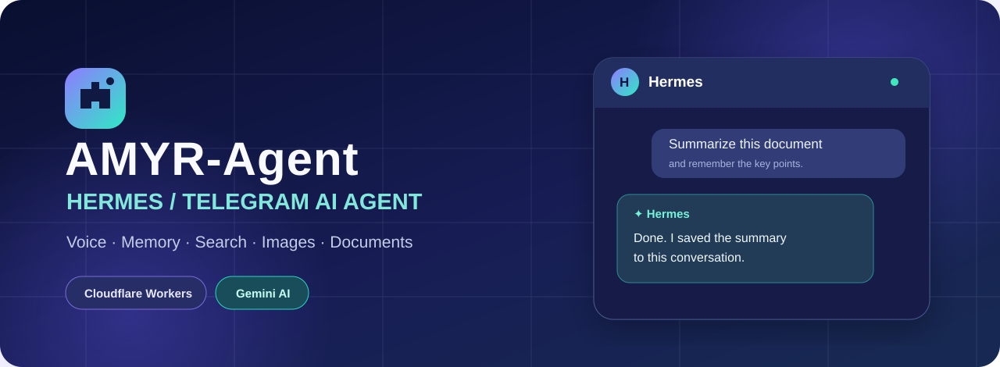
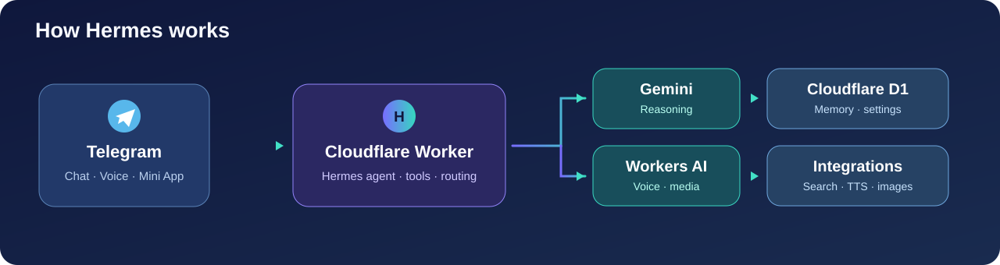

<div align="center">
  

  # AMYR-Agent

  **هرمس؛ دستیار هوشمند تلگرامی روی Cloudflare Workers**

  [](https://developers.cloudflare.com/workers/)
  [](https://www.typescriptlang.org/)
  [](LICENSE)

  [فارسی](#معرفی) · [English](#english) · [راه‌اندازی](#راهاندازی)
</div>

## معرفی

AMYR-Agent نسخهٔ قابل میزبانی شخصی از ربات **هرمس** است: گفتگو با Gemini، حافظهٔ گفتگو، پاسخ صوتی، جست‌وجوی وب و تصویر، ساخت تصویر و فایل، و داشبورد/مینی‌اپ تلگرام. کد روی Cloudflare Workers اجرا می‌شود و داده‌های ماندگار را در D1 نگه می‌دارد.



### قابلیت‌ها

| بخش | رفتار | نیازمندی |
| --- | --- | --- |
| گفتگو | Gemini، ابزارهای عامل، پاسخ کوتاه و هویت قابل تنظیم | کلید Gemini |
| حافظه | نگهداری تاریخچه در D1 و پاک کردن گفتگو با `clear` | D1 |
| گروه | پاسخ به منشن/ریپلای، سیاست احتمالی پاسخ صوتی | تنظیم ربات در گروه |
| صدا | خواندن ویس و پاسخ صوتی؛ مسیرهای جایگزین TTS | Workers AI؛ ElevenLabs اختیاری |
| وب و عکس | جست‌وجوی وب و تصاویر موجود، ساخت تصویر | کلید جست‌وجو / سرویس تصویر |
| خروجی | PDF و فایل‌های دیگر، برنامهٔ وب و ابزارهای داخلی | بسته به نوع خروجی |
| مدیریت | داشبورد، مینی‌اپ، تنظیمات مالک، VIP | شناسهٔ مالک و وب‌هوک |

> قابلیت‌های وابسته به سرویس خارجی فقط پس از افزودن کلید یا binding همان سرویس کار می‌کنند. سهمیه و مدل‌های موجود به حساب ارائه‌دهنده بستگی دارند.

### پاسخ صوتی

- پیام صوتی مستقیم: پاسخ صوتی.
- ریپلای به ویس ربات: حدود **۹۰٪** احتمال پاسخ صوتی.
- ریپلای به پیام متنی ربات در گروه: حدود **۳۵٪** احتمال پاسخ صوتی.
- پیام کوتاه خصوصی: حدود **۳۰٪** احتمال پاسخ صوتی.

این درصدها انتخاب تصادفی هستند؛ هر پیام تضمین نمی‌کند که خروجی ویس باشد.

## راه‌اندازی

### ۱. پیش‌نیازها

- Node.js، npm و یک حساب Cloudflare
- ربات تلگرام ساخته شده با [@BotFather](https://t.me/BotFather)
- کلید Google Gemini
- پایگاه D1 در همان حساب Cloudflare

```bash
git clone https://github.com/Am1rX/AMYR-Agent.git
cd AMYR-Agent
npm ci
npx wrangler login
npx wrangler d1 create amyr-agent-db
```

فایل `wrangler.toml.example` را به `wrangler.toml` کپی کنید. مقدار `database_id` را با شناسهٔ خروجی دستور D1 جایگزین کنید. `BOT_OWNER_ID` باید **شناسهٔ عددی تلگرام** مالک باشد؛ `CREATOR_HANDLE` و نام‌های سازنده هویت عمومی ربات را تعیین می‌کنند. فایل واقعی `wrangler.toml` در git نادیده گرفته می‌شود.

```bash
cp wrangler.toml.example wrangler.toml
cp .dev.vars.example .dev.vars
```

در ویندوز می‌توانید از `Copy-Item` در PowerShell استفاده کنید. برای توسعهٔ محلی، مقادیر `.dev.vars` را کامل کنید. این فایل نیز وارد git نمی‌شود.

### ۲. کلیدهای محیط تولید

کلیدهای واقعی را فقط به‌صورت Worker Secret تنظیم کنید:

```bash
npx wrangler secret put TOKEN
npx wrangler secret put WEBHOOK_SECRET
npx wrangler secret put GEMINI_KEY_1
```

برای جست‌وجو و TTS اختیاری، نام متغیرها در `wrangler.toml.example` و `.dev.vars.example` آمده است. کلیدها را وارد commit نکنید.

### ۳. بررسی و انتشار

```bash
npm run type-check
npm test
npm run deploy
```

پس از انتشار، نشانی Worker را در وب‌هوک تلگرام ثبت کنید. مسیر دریافت آپدیت **`/webhook`** است و مقدار `secret_token` باید با `WEBHOOK_SECRET` یکسان باشد:

```text
POST https://api.telegram.org/bot<BOT_TOKEN>/setWebhook
url=https://<YOUR_WORKER>.workers.dev/webhook
secret_token=<WEBHOOK_SECRET>
```

برای مینی‌اپ، نشانی Worker و تنظیمات Web App ربات را در BotFather مطابق دامنهٔ منتشر شده ثبت کنید.

## پیکربندی هویت و حریم خصوصی

نسخهٔ عمومی هیچ توکن، شناسهٔ مالک، شناسهٔ پایگاه داده یا آیدی شخصی واقعی در کد ندارد. نام ربات **Hermes / هرمس** است. نام و آیدی سازنده از `CREATOR_NAME_FA`، `CREATOR_NAME_EN`، `CREATOR_NAME_AR` و `CREATOR_HANDLE` در تنظیمات Worker خوانده می‌شوند. اطلاعات هر نصب را خود میزبان وارد می‌کند.

## توسعه

ساختارهای اصلی در `src/index.ts` (Worker و تلگرام)، `src/memory.ts` (حافظه)، `src/voiceReplyPolicy.ts` (سیاست پاسخ صوتی)، `src/webSearch.ts` (وب)، `src/exportEngine.ts` (خروجی‌ها) و `tests/` قرار دارند. راهنمای مشارکت در [CONTRIBUTING.md](CONTRIBUTING.md) و گزارش امنیتی در [SECURITY.md](SECURITY.md) است.

## English

AMYR-Agent is a self-hosted Telegram AI agent named **Hermes**, running on Cloudflare Workers with D1 persistence. It includes Gemini chat, conversation memory, voice input and output, web and image search, image and document generation, group behavior, and management dashboards. External capabilities need their respective credentials and provider quota. Follow the [setup steps above](#راهاندازی); deployment identifiers belong in ignored local configuration or Worker secrets.

## License and credits

Licensed under [AGPL-3.0-or-later](LICENSE). This project is derived from [NovaAgent](https://github.com/Hsoofi82/NovaAgent); its license and applicable third-party notices are retained in [THIRD_PARTY_NOTICES.md](THIRD_PARTY_NOTICES.md).
